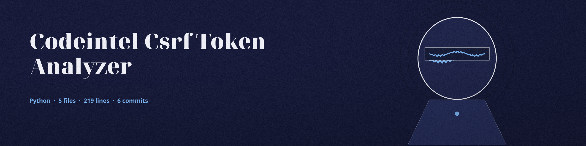

# codeintel-CSRF-Token-Analyzer
Verifies the implementation of CSRF protection mechanisms in web application code, focusing on token generation and validation. Focused on tools for static code analysis, vulnerability scanning, and code quality assurance.

## Install
`git clone https://github.com/ShadowGuard-AI/codeintel-csrf-token-analyzer`

## Usage
`python3 main.py SOURCE_CODE_PATH [--token_name NAME] [--form_field FIELD] [--exclude PATH ...]`

## Parameters
- `-h`: Show help message and exit
- `source_code_path`: Path to the source code directory or file. Required.
- `--token_name`: Name of the CSRF token (default: csrf_token).
- `--form_field`: Name of the CSRF form field (default: csrf_token).
- `--exclude`: List of files or directories to exclude.

## Verified behavior
- A Python file containing a token generation call and a form-field comparison against the token reports both generation and validation logic found.
- A file with neither reports both as not found, and still exits 0. The exit code does not distinguish a clean file from a file with no CSRF logic, so read the log lines, not the exit code, for the result.

## License
See LICENSE.
